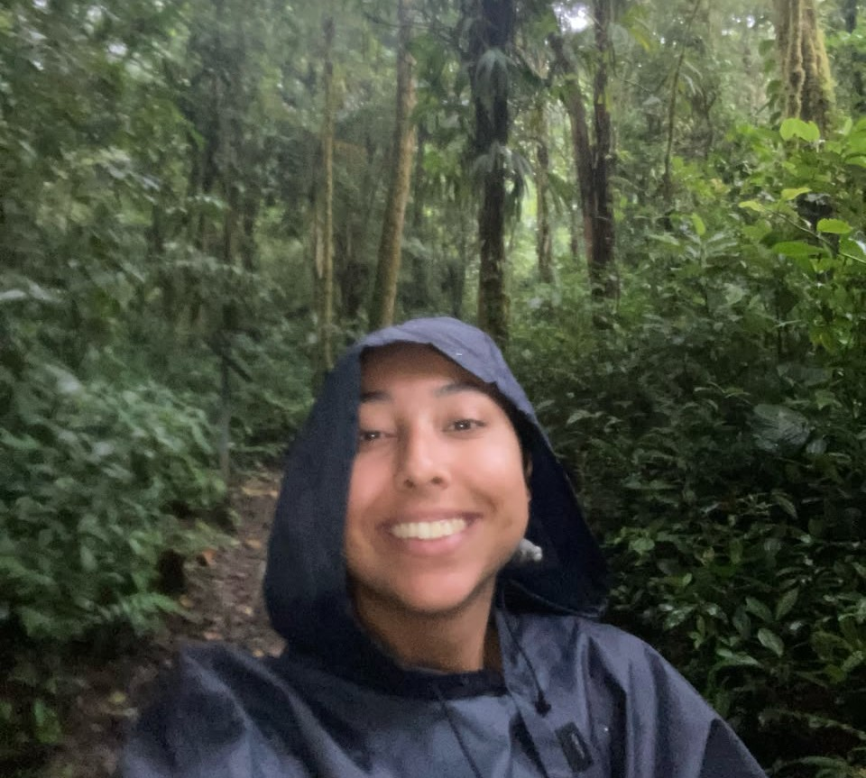

:::::: perfil-superior
::: perfil-foto
{fig-alt="Fotografía de perfil"}
:::

:::: perfil-info
# Dorene González

## Estudiante de Bachillerato en Biología Tropical

Escuela de Ciencias Biológicas\
Universidad Nacional, Costa Rica

::: enlaces-perfil
[<i class="bi bi-envelope-fill"></i> Correo](mailto:dorene.gonzalez.gonzalez@est.una.ac.cr)

[<i class="bi bi-github"></i> GitHub](https://github.com/dorenegg)

[<i class="bi bi-person-badge-fill"></i> ORCID](https://orcid.org/0000-0002-3665-6541)

[<i class="bi bi-linkedin"></i> LinkedIn](https://linkedin.com/in/dorene-gonzález-gonzález-2116a1263)
:::
::::
::::::

------------------------------------------------------------------------

## Biografía

Estudiante avanzada de Biología Tropical con experiencia en trabajo de laboratorio e investigación de campo. Con alta motivación y afinidad por ambientes de aprendizaje prácticos. Tengo especial interés por comprender cómo las actividades antropogénicas impactan la dinámica natural de los ecosistemas, especialmente en entornos urbanos. Mis metas profesionales están vinculadas con la colaboración multidisciplinaria en proyectos que contribuyan al desarrollo de soluciones ambientalmente sostenibles que permitan la restauración de los ecosistemas en entornos altamente urbanizados, especialmente enfocados en la correcta gestión de residuos. Además, presento un gran deseo de trabajar a mano con las comunidades en la educación ambiental y sensibilización al impacto que tienen nuestras actividades cotidianas en el ambiente.

------------------------------------------------------------------------

## Áreas de interés

- Ecología
- Conservación
- Ecotoxicología
- Microalgas
- Calidad de aguas

------------------------------------------------------------------------

## Habilidades

- R
- Git y GitHub
- QGIS
- Microsoft Office

------------------------------------------------------------------------

## Formación académica

**Universidad Nacional (UNA)**

Bachillerato en Biología con énfasis en Biología Tropical

*2022 – Presente*

**Museo Nacional de Costa Rica**

Entomología Basica

*Julio 2026*

**University of Veterinary Medicine Hannover (TiHo)**

Tropical Wildlife Biology Course - Costa Rica

*Marzo-Abril 2026*

**Universidad de Costa Rica**

Aspectos Básicos de la Biología y Bioquímica del Cáncer

*Enero-Marzo 2026*
