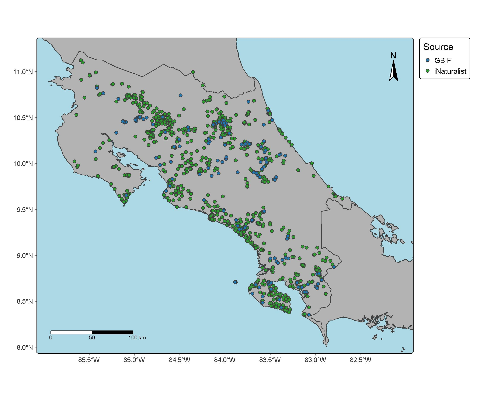

## Introducción

Se realizó la obtención de ocurrencias de una especie de interés a través de la descarga de registros en diferentes bases de datos de acceso libre en donde se almacenan registros de especies a nivel mundial, como GBIF y iNaturalist.

## Objetivo

El objetivo de la práctiva fue aprender el proceso de descarga de ocurrencias desde una API y su posterior limpieza para la obtención de una base datos unificada con los registros una especie de interés de GBIF y iNaturalist utilizando los paquetes de R “gbif” y “rinat” .

## Metodología

Utilizando los paquetes de R “gbif” v 3.8.5 [@rgbif] y “rinat” v 0.1.10 [@rinat]se realizó la descarga de todas la ocurrencia disponibles de la especie de interés.

Posteriormente se procedió a limpiar las bases de datos de cada repositorio. Se eliminaron todas aquellas variables que no se encontraban en el área de estudio y se estandarizaron para poder unificar ambas bases obtenidas. Luego, se eliminaron todos aquellos datos que presentaron coordenadas inválidas, ceros, latitud-longitud iguales, centroides administrativos y coordenadas oscurecidas.

## Resultados

{width="493"}

Fig 1. Mapa de Costa Rica mostrando las ocurrencias de la especie *Craugastor fitzingeri* a partir de los datos descargados desde las API de GBIF y iNaturalist en el curso de Ecología de Poblaciones y Comunidades, 2026

## Interpretación

La limpieza de las ocurrencias nos permite garantizar una mayor confiabilidad de los datos obtenidos, permitiendo la elaboración de análisis estadísticos más confiables.

## Conclusiones

La influencia del sesgo observacional es difícil de remover, por lo que el análisis de distribución debe de realizarse con mucho cuidado, una mayor concentración de observaciones no necesariamente implica una mayor abundancia o ausencia en regiones en donde no las hay. Para reducir este efecto se han diseñado diferentes metodologías, como es la calibración de los puntos. A pesar de esto, estos datos siguen siendo herramientas de gran utilidad que facilitan la realización de estudios científicos sobre una gran variedad de organismos.

## 
