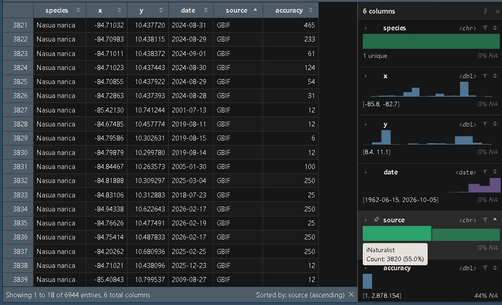

## Introducción

La obtención de ocurrencias de alguna especies de interés se puede realizar a través de la descarga de registros en diferentes bases de datos. Las bases de datos públicas son grandes repositorios de acceso libre en donde se almacenan registros de especies a nivel mundial, algunas como GBIF concentran datos de grado académico los cuales pueden ser utilizados en investigación. Existen otras bases de ciencia ciudadana en donde la población en general puede incluir sus observaciones, sin embargo, puede que presenten errores de identificación por lo que se deben filtrar aquellos datos que sean de grado académico para reducir la probabilidad de errores en los datos.

## Objetivo

Descargar ocurrencias de una especies de interés de bases de datos de acceso público a través de los paquetes de R “gbif” y “rinat” , para lograr la obtención de una base de datos unificada con los registros de la especie.

## Metodología

Utilizando los paquetes de R “gbif” v 3.8.5 [@rgbif] y “rinat” v 0.1.10 [@rinat]se realizó la descarga de todas la ocurrencia disponibles de la especie de interés.

Posteriormente se procedió a limpiar las bases de datos de cada repositorio. Se eliminaron todas aquellas variables que no se encontraban en el área de estudio y se estandarizaron para poder unificar ambas bases obtenidas. Luego, se eliminaron todos aquellos datos que presentaron coordenadas inválidas, ceros, latitud-longitud iguales, centroides administrativos y coordenadas oscurecidas.

## Resultados

Se obtuvo una base de datos unificada conteniendo la ocurrencias obtenidas de ambos repositorios

Fig 1. Base de datos unificada y limpiada con las ocurrencias provenientes de GBIF y iNaturalist.

## Interpretación

La limpieza de las ocurrencias nos permite garantizar una mayor confiabilidad de los datos obtenidos, permitiendo la elaboración de análisis estadísticos más confiables.

## Conclusiones

La influencia del sesgo observacional es difícil de remover, por lo que el análisis de distribución debe de realizarse con mucho cuidado, una mayor concentración de observaciones no necesariamente implica una mayor abundancia o ausencia en regiones en donde no las hay. Para reducir este efecto se han diseñado diferentes metodologías, como es la calibración de los puntos. A pesar de esto, estos datos siguen siendo herramientas de gran utilidad que facilitan la realización de estudios científicos sobre una gran variedad de organismos.

## 
