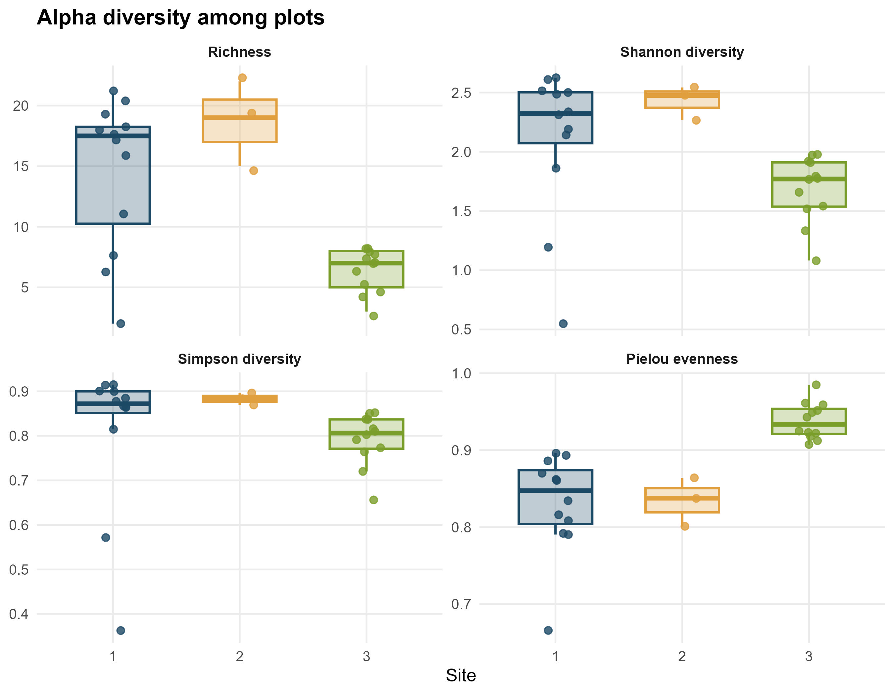

## Introducción

En esta práctica se abordó el cálculo de diversas métricas e índices ecológicos relevantes para el estudio de la diversidad de especies y la composición de las comunidades biológicas, mediante el uso del paquete Vegan en R.

## Objetivo

Calcular, a partir de una base de datos de registros de especies vegetales en diferentes sitios de muestreo, la abundancia, riqueza y los índices de diversidad, dominancia, equitatividad y similitud mediante el paquete Vegan, con el propósito de caracterizar y comparar la composición de las comunidades estudiadas.

## Metodología

En primer lugar, se proyectaron espacialmente las observaciones sobre una capa cartográfica del área de estudio, con el propósito de visualizar la distribución de las especies en los diferentes sitios de muestreo. Seguidamente, se calculó la abundancia de cada especie y, mediante la función *pivot_wider*, se reorganizaron los datos en una tabla que permitió visualizar la abundancia de las especies en cada sitio.

Posteriormente, se ajustó la disposición de los datos al formato requerido por el paquete Vegan v 2.7-6 [@vegan] para calcular la abundancia total (N), la riqueza de especies (S), los índices de diversidad de Shannon y Simpson, el índice de dominancia, el valor máximo de Shannon y el índice de equitatividad de Pielou. Estos cálculos se realizaron para cada sitio de muestreo (diversidad alfa) y para el conjunto del área de estudio (diversidad gamma).

Finalmente, se calcularon los índices de Jaccard y Sørensen para evaluar la similitud en la composición de especies entre los sitios de estudio.

## Resultados

El sitio 1 presentó la mayor abundancia total, con 4196 individuos, así como la mayor riqueza, con 28 especies. Por el contrario, el sitio 3 registró la menor abundancia, con 222 individuos, y la menor riqueza, con 12 especies.

De acuerdo con los índices de Shannon (2,85) y Simpson (0,92), el sitio 1 presentó la mayor diversidad. Por su parte, el sitio 3 registró la mayor equitatividad (0,946) y un valor de dominancia de 0,104 (Figura 1). Asimismo, el sitio 3 presentó la mayor disimilitud en la composición de especies respecto a los demás sitios de estudio.

Figura 1.Diversidad alfa de los sitios de estudio: 1) Colorado Desert, 2) Mojave Desert y 3) SoCal Mountains.

## Interpretación

Los sitios 1 y 2 presentaron una composición de especies más similar entre sí, posiblemente debido a que ambos corresponden a ecosistemas desérticos que comparten determinadas condiciones ambientales. En contraste, el sitio 3 corresponde a un ecosistema montañoso con características ambientales diferentes, lo cual podría explicar su mayor disimilitud respecto a los otros sitios, según los valores obtenidos mediante el índice de Jaccard.

Asimismo, se observaron diferencias en la riqueza de especies, particularmente en el sitio 3, que presentó el menor valor. Estas diferencias podrían estar relacionadas con las condiciones ambientales propias de los ecosistemas montañosos, como la variación altitudinal y los cambios asociados en temperatura, humedad y disponibilidad de hábitats, los cuales pueden influir en la distribución y composición de las comunidades vegetales. Sin embargo, sería necesario evaluar estas variables para determinar su contribución a los patrones observados.

## Conclusiones

La caracterización de la diversidad de especies requiere integrar diferentes métricas e índices ecológicos que permitan describir la riqueza, abundancia, equitatividad y composición de las comunidades biológicas. La utilización conjunta de estos indicadores facilita la comparación entre sitios y permite identificar diferencias en la estructura de las comunidades que podrían estar relacionadas con las condiciones ambientales de cada ecosistema.

Asimismo, los resultados evidencian la importancia de considerar diferentes componentes de la diversidad, ya que una mayor riqueza o abundancia de individuos no necesariamente implica una mayor equitatividad en la distribución de las especies.

## 
