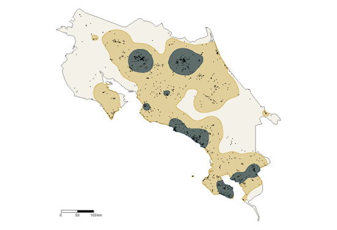

## Introducción

En esta práctica se estimó la densidad de kernel (KDE) a partir de registros de ocurrencia de *Craugastor fitzingeri* en Costa Rica, con el propósito de identificar las principales concentraciones espaciales de observaciones de la especie.

## Objetivo

Estimar la densidad de kernel (KDE) a partir de registros de ocurrencia de *C. fitzingeri* y evaluar el efecto de diferentes valores del parámetro de suavizado (sigma) sobre la representación espacial de las concentraciones de registros, con el fin de identificar el valor más apropiado para su visualización.

## Metodología

En primer lugar, se transformó el sistema de coordenadas de las capas geográficas del área de estudio, correspondiente a Costa Rica, del sistema WGS84 al sistema proyectado CRTM05. Asimismo, las coordenadas de los registros de ocurrencia se transformaron al mismo sistema, con el propósito de trabajar con unidades métricas y garantizar la compatibilidad espacial entre las capas.

Posteriormente, se establecieron los parámetros necesarios para calcular la densidad de kernel, específicamente el ancho de banda (sigma), que determina el grado de suavizado de las concentraciones espaciales, y la resolución del ráster, que define el tamaño de las celdas utilizadas para representar los resultados.

Inicialmente, se utilizó un valor de sigma de 5000 m y una resolución espacial de 500 m. Seguidamente, se modificó sigma a 1000, 2000 y 10 000 m, manteniendo la misma resolución, con el propósito de comparar el efecto de estos valores sobre la representación de las concentraciones de registros. Finalmente, los resultados se visualizaron mediante mapas ráster para identificar las principales áreas de concentración espacial.

## Resultados

Los mapas de densidad de kernel permitieron identificar las principales concentraciones espaciales de registros de *Craugastor fitzingeri* en Costa Rica. A pesar de las modificaciones realizadas en el parámetro sigma, se mantuvieron cinco concentraciones relevantes: dos en la región norte del país, correspondientes a las zonas de Sarapiquí y San Carlos; una en el Pacífico Central; y dos en el Pacífico Sur.

Los mapas generados con valores de sigma de 1000 y 2000 m presentaron concentraciones más localizadas y una menor continuidad espacial. En contraste, el valor de sigma de 10 000 m produjo una superficie considerablemente más suavizada, con una mayor conexión entre las concentraciones de registros y una representación espacial más continua.

Las principales concentraciones identificadas coincidieron con regiones que presentan actividad turística, lo cual podría estar relacionado con diferencias en el esfuerzo de muestreo y la accesibilidad de los sitios. Por tanto, los valores elevados de KDE no permiten afirmar que estas regiones presenten una mayor abundancia de la especie.

**Figura 1.** Mapa de densidad de kernel (KDE) con un valor de sigma de 10km,elaborado a partir de registros de ocurrencia de *Craugastor fitzingeri* en Costa Rica, durante el curso de Ecología de Poblaciones y Comunidades, 2026.

## Interpretación

Las principales concentraciones de registros de *Craugastor fitzingeri* se localizaron en regiones que presentan condiciones ambientales potencialmente favorables para la especie, como ambientes húmedos de baja elevación. Sin embargo, estas áreas también pueden presentar una mayor accesibilidad y actividad turística, factores que podrían favorecer una mayor frecuencia de observaciones y generar sesgos asociados con el esfuerzo de muestreo.

Por otra parte, las diferencias observadas entre los mapas evidencian la influencia del parámetro sigma sobre la representación espacial de los registros. Los valores menores permitieron identificar concentraciones más localizadas, mientras que los valores mayores produjeron superficies más continuas, aunque con una menor diferenciación espacial entre las agrupaciones.

En consecuencia, las concentraciones identificadas mediante KDE deben interpretarse como áreas con una mayor densidad de registros y no necesariamente como regiones con una mayor abundancia de individuos o condiciones ambientales óptimas. Para establecer estas relaciones sería necesario complementar el análisis con muestreos de campo estandarizados y variables ambientales que permitan evaluar la distribución de la especie y los posibles sesgos de observación.

## Conclusiones

El parámetro sigma influye considerablemente en la representación de las concentraciones espaciales obtenidas mediante KDE, por lo que su selección debe considerar la escala de análisis, los objetivos del estudio y las características de los registros disponibles. Los valores menores permiten identificar agrupaciones más localizadas, mientras que los mayores generan superficies más suavizadas y continuas.

La estimación de densidad de kernel constituye una herramienta útil para identificar patrones espaciales en los registros de ocurrencia. Sin embargo, las concentraciones obtenidas no representan directamente la abundancia de organismos ni la idoneidad del hábitat, especialmente cuando existen diferencias en el esfuerzo de muestreo.

Asimismo, las superficies generadas mediante KDE no deben interpretarse como límites comprobados de distribución de la especie, sino como representaciones de la concentración espacial de los registros disponibles.
