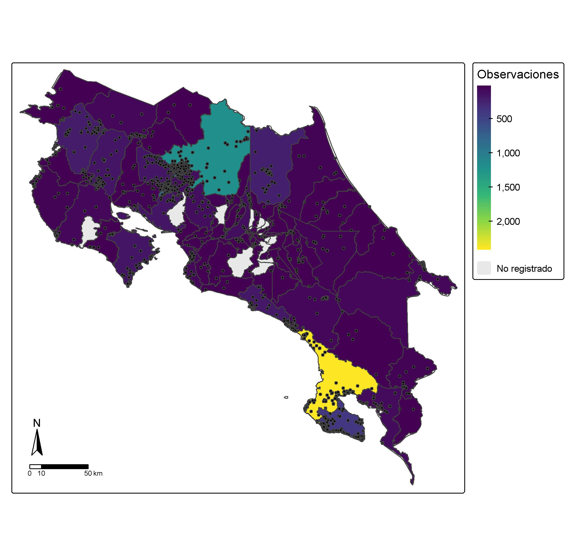

## Introducción

Se procesaron y analizaron los registros espaciales de ocurrencia de una especie de interés vinculándolos con límites cantonales, provinciales y unidades biogeográficas en Costa Rica mediante el uso de herramientas de sistemas de información geográfica

## Objetivo

Evaluar la distribución espacial y administrativa de las observaciones de la especie a nivel de cantones, provincias y regiones biogeográficas.

Analizar los patrones temporales, latitudinales y longitudinales de los registros históricos de la especie.

## Metodología

Se cargaron diferentes shapefiles de límites políticos y biogeográficos, a estos se le validaron las geometrías, fueron transformados a mismo sistema de coordenadas (WGS84) y se limpiaron los nombres.

Luego, se integraron los puntos de ocurrencias con la capa administrativas y se corrigieron los registros costeros mediante la función "st_nearest_feature".

Por últimos de agruparon los registros por cantón, provincia, anual y elevación.

## Resultados

Se obtuvo un mapa en donde se evidencia la distribución de la especie de estudio *Nasua narica* sobre una capa geográfica de los límites cantonales En este se puede evidenciar una fuerte concentración de observaciones en algunos cantones, sin embargo, esto no representa nesariamente una mayor abundancia de la especie, si no una mayor concentración de observaciones registradas.

Fig 1. Distribución de *Nasua narica* a nivel cantonal.

## Interpretación

La concentración de observaciones en ciertos cantones puede estar asociada a zonas de mayor tránsito de personas o mayor concentración de estudios, lo cual puede haber aumentado el número de reporte de avistamientos. Este tipo de distribución debe de ser analizada con cautela para evitar una sobreestimación de distribución de la especie en estas zonas y un subestimación en zona con menos observaciones que puede que sean menos concurridas.

## Conclusiones

Proyectar la distribución de especies sobre límites políticos es una herramienta clave para la planificación territorial, el diseño de políticas públicas de conservación y la toma de decisiones administrativas locales. Sin embargo, su interpretación exige cautela: las divisiones políticas no reflejan las barreras ecológicas del hábitat ni los límites naturales de las poblaciones. Asimismo, el sesgo de muestreo concentrado en ciertos cantones puede distorsionar la percepción de la presencia real de la especie, por lo que este tipo de cartografía debe complementarse siempre con variables ambientales y modelos de nicho ecológico.

## 
