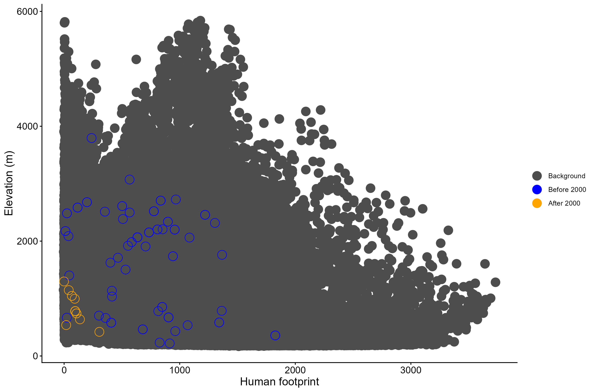

## Introducción

Se procesaron y analizaron datos de ocurrencia de especies de anfibios en Costa Rica utilizando capas ráster ambientales (clima, elevación y huella humana) para evaluar su nicho ecológico y distribución espacial.

## Objetivo

Caracterizar el espacio ambiental bidimensional que ocupan las especies en función de gradientes térmicos, de precipitación, altitudinales y de intervención antrópica.

Visualizar la relación entre los puntos de presencia y la disponibilidad ambiental de referencia (background) del territorio nacional.

## Metodología

Se cargaron los registros de ocurrencias y capas espaciales. Luego se homologaron las resoluciones, extensiones y proyecciones de los mapas ráster mediante recorte y remuestreo. A estas de les extrajeron los valores de las variables ambientales para cada punto de ocurrencia. Y se generaron gráficos de dispersión bivariados.

## Resultados

Uno de los gráficos generados evidencia de manera directa el impacto severos de procesos históricos de declive (típicamente asociados en la región a factores como el hongo quitridio y cambios ambientales), mostrando cómo la especie desapareció de la mayor parte de su rango altitudinal original. Además, a concentración exclusiva de los registros posteriores al año 2000 en el extremo inferior de elevación y baja perturbación sugiere la existencia de un refugio ambiental o climático donde las poblaciones sobrevivientes han logrado persistir

Fig 1.  Distribución altitudinal de *Craugastor ranoides* con respecto a Índice de impacto Humano.

## Interpretación

El gráfico de dispersión bivariados permite contrastar el espacio ambiental disponible frente al espacio efectivamente ocupado en distintos momentos temporales, facilitando la evaluación de la vulnerabilidad de la especie ante la combinación de presiones humanas y factores topográficos.

## Conclusiones

Es de gran importancia la gestión y depuración de las incompatibilidades geométricas entre las capas ráster (resoluciones y extensiones distintas), ya que se requiere de algunos ajustes precisos para evitar errores en la extracción de datos.

Esta metodología se puede utilizar para evaluar la vulnerabilidad de especies ante el cambio climático, modelar pérdida de hábitat por presión humana y priorizar áreas para la conservación o restauración de corredores biológicos.

## 
