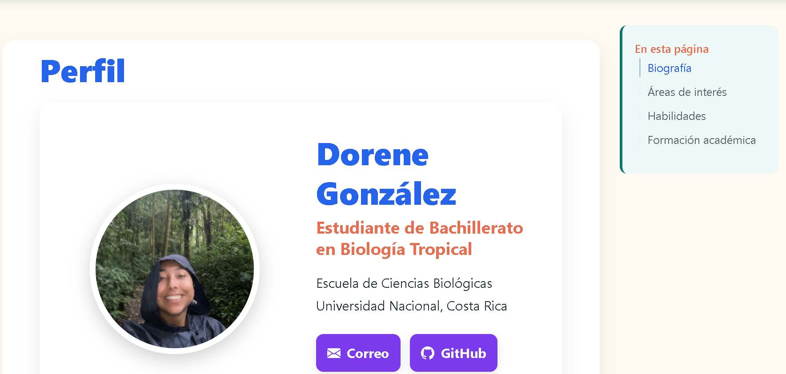

## Objetivo

Creación de un sitio web personalizado.

## Materiales y herramientas

- RStudio
- Quarto
- Git
- GitHub

## Procedimiento

Explique de forma ordenada los pasos realizados durante la práctica.

1.  *Creación del repositorio con Template Repository*

    Ingresar a **Scientific Portfolio Template** en GitHub

    Seleccionar "Use this template" y seleccionar su cuenta como propietario

    Asignar nombre y crear el repositorio

2.  *Clonar repositorio en RStudio*

    En RStudio crear un proyecto tipo **Version Control - Git**

    Pegar URL del repositorio creado en RStudio

    Seleccionar carpeta de destino y crear proyecto

3.  *Estructura del proyecto*

    Identificar los principales componentes del sitio web:

    1.  \_quarto-yml: formato del texto y composición del la página web

    2.  index.qmd: información preliminar de los contenidos, introducción a la página y herramientas y afiliación

    3.  about.qmd: información a cerca del creado de la página web

    4.  portfolio.qdm: sección del protafolio en donde se incorporan las prácticas realizadas

    5.  práctica-ejemplo.qdm: guía sobre el formato a seguir para el reporte de lo realizado durante las prácticas

    6.  styles.css: estilo de las letras utilizadas

    7.  carpeta images: imágenes utilizadas en la página

    8.  carpeta docs: archivos salida de las secciones de la página web

4.  *Renderizar*

    En la terminal del RStudio ejecutar "quarto render"

5.  *Explorar el sitio web*

    Navegar por las pestañas:

    Inicio, Perfil, Portafolio, Práctica de ejemplo

    Observar estructura

6.  *Personalizar imágenes*

    Remplazar imágenes en la respectiva carpeta

    Verificar que el formato del archivo coincida con el establecido en el ".qmd"

    Ejecutar "quarto render"

    Verificar las imágenes en el sitio web

7.  *Personalizar perfil profesional*

    Editar archivo about.qmd:

    nombre, correo electrónico, GitHub, ORCID, LinkedIn, biografía, áreas de interés, habilidades y formación académica

    Renderizar y revisar que se haya actualizado en "Perfil"

8.  *Personalizar portada*

    Editar archivo index.qmd:

    nombre, carrera, última actualización

9.  *Explorar portafolio*

    Identificar en el archivo portfolio.qdm:

    práctica ejemplo, prácticas futuras, organización general de portafolio

    Abrir práctica-ejemplo.qdm y observar el formato

10. *Configurar GitHub Pages*

    La primera publicación del portafolio se realiza en GitHub

    1.  Ejecute "quarto render" para actualizar "docs"
    2.  Seleccionar en el repositorio **Settings - Code and automation-Pages-Build and deployment-Source-Deploy from branch-main**
    3.  En el menu de carpeta seleccionar **"/docs" - Save**

11. *Guardar y enviar cambios desde la pestaña Git de RStudio*

    Ejecutar "quarto render"

    Abrir pestaña Git

    Revisar lista de archivo modificados

    Marcar "Staged" de todos los archivos

    Incluir según los cambios

    Clic en **Commit,** en el mensaje escribir algo representativo del cambio

    Nuevamente Commit, cerrar cuando indique que fue creado correctamente

    En la misma ventana selccionar **Push,** esperar a ser enviados

12. *Verificar sitio*

    En el repositorio GitHub

    Settings-Pages-Visit site

    Comprobar secciones

    1.  Crear y clonar repositorio
    2.  Personalizar portada y perfil
    3.  Sustituir imágenes
    4.  Renderizar sin errores
    5.  Configurar GitHub Pages
    6.  Realizar Commit y Push
    7.  Publicación del sitio web

## Resultados

Creación y perzonalización exitosa de un sitio web

## Figuras y tablas

## Reflexión final

En esta práctica se aprendió a cómo realizar una personalización de una plantilla de un sitio web, además de cómo mantenerla actualizada y respaldada tanto en línea como en la memoria del la computadora. En ocasiones editar la página puede ser un poco confuso si no se sabe muy bien donde se ubican los códigos o si se olvidad de realizar las actualizaciones periódicamente mientras se trabaja. Esta herramienta resultará muy útil para proyectos los cuales se requiere de exposición en línea, siendo una manera sencilla de divulgar información o darse a conocer.
