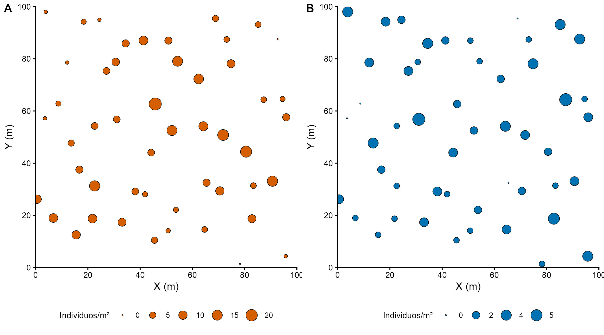

## Introducción

En esta práctica se determinó el patrón de distribución espacial de dos especies herbáceas en un área de estudio de 1 ha, establecida en el Parque Recreativo de la Universidad para la Paz. Se esperaba que *Elephantopus mollis* presentara una distribución agregada debido a sus hábitos de crecimiento, mientras que para *Rhynchospora nervosa* se planteó una distribución compatible con un patrón aleatorio.

## Objetivo

Evaluar y comparar los patrones de distribución espacial de dos especies vegetales a partir de datos de abundancia obtenidos mediante un muestreo por cuadrículas.

## Metodología

Se delimitó un área de estudio de 100 × 100 m (1 ha), la cual se dividió en 50 sectores de 10 × 20 m. Dentro de cada sector se estableció aleatoriamente una cuadrícula de 1 × 1 m como unidad de muestreo, para un total de 50 cuadrículas. Se definió un punto de referencia (0, 0) para determinar las coordenadas espaciales (X y Y, en metros) de cada cuadrícula dentro del área de estudio. En cada cuadrícula se registró el número de individuos de *E. mollis* y *R. nervosa*, sin considerar las variables ambientales.

Posteriormente, se calculó el índice de dispersión (ID = varianza/media), cuyos valores permiten identificar patrones de distribución uniforme (ID menor que 1), aleatoria (ID cercano a 1) o agregada (ID mayor que 1). Seguidamente, se aplicó una prueba de chi-cuadrado (χ²) para evaluar si los patrones de dispersión observados diferían significativamente de los esperados bajo una distribución aleatoria.

Finalmente, se evaluó el ajuste de las frecuencias de abundancia observadas a modelos probabilísticos teóricos: la distribución binomial negativa para *E. mollis* y la distribución de Poisson para *R. nervosa*.

## Resultados

*Elephantopus mollis* presentó un índice de dispersión de 3.91, superior a 1, compatible con un patrón de distribución agregada. La prueba de chi-cuadrado evidenció una diferencia estadísticamente significativa respecto al patrón aleatorio (χ² = 191,8; gl = 49; p menor que 0,001), lo cual concuerda con una varianza considerablemente mayor que la media. Asimismo, no se encontraron diferencias estadísticamente significativas entre las frecuencias observadas y las esperadas bajo el modelo de distribución binomial negativa.

Por su parte, *Rhynchospora nervosa* presentó un índice de dispersión de 0.98, cercano a 1, compatible con un patrón de distribución aleatoria. La prueba de chi-cuadrado no evidenció diferencias estadísticamente significativas respecto a este patrón (χ² = 48,0; gl = 49; p = 0,512). Además, se observó un ajuste compatible con la distribución de Poisson (χ² = 2,8; gl = 2; p = 0,249).

**Figura 1.** Distribución espacial de las especies estudiadas en un área de muestreo de 1 ha, establecida en el Parque Recreativo de la Universidad para la Paz. El tamaño de los círculos representa la abundancia registrada en cada cuadrícula de 1 m². El panel A muestra la distribución espacial de *Elephantopus mollis*, mientras que el panel B corresponde a *Rhynchospora nervosa*.

## Interpretación

Ambas especies presentaron patrones de distribución espacial compatibles con las hipótesis planteadas a partir de sus hábitos de crecimiento. *Elephantopus mollis* presentó una distribución agregada, posiblemente relacionada con su crecimiento mediante la formación de rosetas y la concentración de individuos en determinadas áreas. Este patrón también podría estar influenciado por interacciones competitivas y condiciones ambientales locales que favorezcan el establecimiento de individuos en sitios específicos.

Por otro lado, *Rhynchospora nervosa* presentó un patrón de distribución compatible con la aleatoriedad, compatible con su crecimiento por medio de rizomas lo cual le permite dispersarse con mayor facilidad en un área.

## Conclusiones

Los hábitos de crecimiento de las especies vegetales pueden proporcionar información relevante para formular hipótesis sobre sus patrones de distribución espacial. Sin embargo, es necesario complementar estas predicciones mediante muestreos y análisis estadísticos, debido a que la distribución de las especies también puede estar influenciada por factores como la disponibilidad de recursos, las interacciones con competidores, herbívoros y patógenos, así como las condiciones ambientales del sitio.

El muestreo por cuadrículas constituye una metodología útil para caracterizar los patrones de distribución espacial de las especies, especialmente en áreas pequeñas y ambientes de baja complejidad estructural. No obstante, su implementación en áreas extensas o ecosistemas heterogéneos puede requerir una mayor inversión de tiempo y recursos. Por tanto, la selección del tamaño y la distribución de las unidades de muestreo debe considerar las características de las especies y la escala espacial del estudio.
