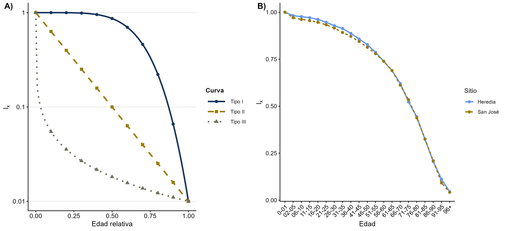

## Introducción

En esta práctica se llevó a cabo la elaboración de tablas de vida a partir de datos de mortalidad obtenidos en dos cementerios.

## Objetivo

Construir y analizar tablas de vida a partir de registros de mortalidad humana obtenidos en cementerios de Heredia y San José, con el propósito de caracterizar patrones de supervivencia, evaluar su correspondencia con los modelos teóricos de curvas de supervivencia Tipo I, Tipo II y Tipo III, y determinar si existen diferencias en la distribución de las edades de muerte entre ambas localidades.

## Metodología

Se combinaron los registros de ambos cementerios y a partir de la edad de muerte, se agruparon los datos en clases de edad para construir tablas de vida de cohortes estáticas por sitio (Heredia y San José). Se calcularon los siguientes parámetros:

dₓ: número de muertes registradas en cada clase de edad.

nₓ: número de individuos sobrevivientes al inicio de la clase de edad.

lₓ: proporción de la cohorte que sobrevive hasta la clase de edad x.

qₓ: mortalidad durante el intervalo.

Adicionalmente, se generó un resumen descriptivo de la edad al momento de la muerte por sexo, calculando la mediana y los cuartiles (Q1 y Q3). Para evaluar si existen diferencias estadísticamente significativas en la distribución de la edad de muerte entre sitios y entre sexos, se aplicó la prueba de Kolmogorov-Smirnov. Y se utilizó la prueba de Mann-Whitney para evaluar si existen diferencias en la posición general de las edades de muerte por rangos.

Se utilizaron los paquetes “tidyverse” v 2.0.0 [@tidyverse] para la manipulación de datos y “gt” v 1.3.0 [@gt] para la edición de las tablas demográficas.

## Resultados

Se recopilaron datos de 2763 individuos entre ambos cementerios. Se observó que cerca del 80 % de los individuos alcanzó la categoría de 51–55 años en ambas localidades (Heredia: (lx = 0.786), San José: (lx = 0.779). La mayor concentración de fallecimientos ocurrió en edades avanzadas. Se observó el mayor número de muertes se registró en la categoría de 76–80 años en Heredia (dx = 169) y de 86–90 años en San José (dx = 160), las curvas de supervivencia presentaron gran superposición entre ambos sitios (Figura 1B), describiendo el comportamiento de una curva de supervivencia de tipo I (Figura 1A).

Figura 1. A) Curvas de supervivencia teóricas en función de la edad relativa que ilustran los patrones teóricos de Tipo I (mortalidad tardía), Tipo II (mortalidad constante) y Tipo III (mortalidad temprana). B) Curva de supervivencia (lx) por grupos de edad obtenida para las poblaciones de Heredia (línea azul) y San José (línea café).

## Interpretación

Esta tabla de vida permitió identificación de los rango de vida en donde mueren más individuos y la probabilidad de supervivencia en cada uno de estos rangos. Al observar estos patrones se logró identificó que el patrón presentado es de Tipo I, en donde hay una mortalidad tardía de los individuos.

## Conclusiones

La tablas de vida permitieron observar los patrones de mortalidad en las poblaciones. El análisis de estos patrones es que nos ayudan a identificar cuáles son los rangos de vida más vulnerables en una poblaciones y así poder enforcar esfuerzos para resguardar la especie y mejorar estas tasas de supervivencia. Esto es particularmente importante en la conservación de especies en peligro de extinción, ya que permite focalizar los esfuerzos de conservación que aquellos que corren más peligro.

## 
