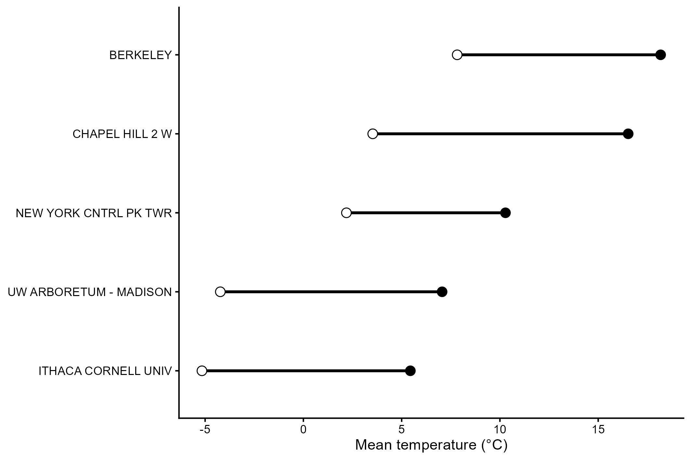
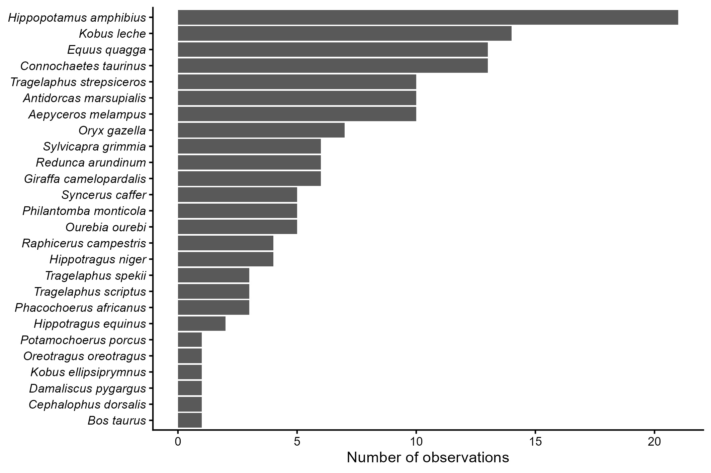

## Introducción

En esta práctica se llevó a cabo la organización de una base de datos la cual contaba con diferentes errores que dificultan su procesamiento y análisis estadístico, a través de la librería "tidydata" la cual permite analizar datos y conflictos y reorganizarlos.

## Objetivo

Organizar bases de datos que presenten errores o redundancias que dificulten su análisis a través de la librería "tidydata" en R.

## Metodología

**Procesamiento, Limpieza y Estructuración de Datos (*Tidy Data*)**

El procesamiento y depuración de los datos se realizó en el entorno R utilizando principalmente el paquete tidyverse (adicionalmente se utilizaron los paquetes dplyr, tidyr, readr, lubridate y ggplot2) y el paquete gt para la elaboración de tablas.

1.  **Reestructuración y Estandarización de Variables:** Se transformaron tablas anchasa formato largo para unificar variables temporales (días) en una sola columna. Posteriormente, se reestructuraron las variables climáticas en columnas independientes. Se corrigieron los nombres de los campos e información taxonómica utilizando la función separate(). Asimismo, se unificaron el género y la especie (unite()) para conformar el nombre científico binomial.

2.  **Ajuste de Fechas y Tipos de Datos:** Las fechas se unificaron y transformaron a un formato estandarizado de fecha (YYYY-MM-DD) empleando as_date(). Las variables numéricas se tranformaron a caracteres a tipo numérico con mutate() y across().

3.  **Para eliminar la redundancia de datos, la información depurada se dividió en dos entidades o tablas independientes:**

    - Tablas de metadatos (información geográfica de las estaciones climáticas o taxonomía de ungulados).

    - Tablas de registros u observaciones temporales/de campo.

**Análisis Descriptivo y Visualización de Resultados**

- **Gráficos:** Se calcularon promedios de temperatura mínima y máxima por estación, generando un gráfico de rangos mediante ggplot2 ordenado jerárquicamente. Para los datos taxonómicos, se contabilizó la frecuencia de observaciones por especie y se representó en un gráfico de barras horizontales.  

- **Tablas de Resumen:** Se construyeron cuadros descriptivos resumidos por estación climática o clasificación taxonómica mediante la librería gt.

## Resultados

El valor mínimo de temperatura se reportó para la estación meteorológica de Ithaca Cornell University con -5.2 °C, ubicada a una altitud de 292.6 m.s.n.m. Y el valor máximo de temperatura fue reportado en la estación de Berkeley de 18.2°C, ubicada a 94.5 m.s.n.m

Fig 1. Promedio de temperatura reportado en cinco estaciones meteorológicas durante Marzo (2010-2020).

Se encontraron 26 especies distribuidas  en 4 familias del orden Artiodactyla y 1 del orden Perissodactyla, pertenecientes a la clase Mammalia, la familia Bovidae siendo la más abundante con 21 especies de 26 registradas.

Fig 2. Especies de ungulados reportados en Angola.

## Interpretación

Las transformación de la base de datos permitió una mejor organización de la información, facilitando la obtención de los registros y su visualización a través de la creación de figuras y tablas.

## Conclusiones

La mayores dificultades de la organización de los es la determinación de cuales filas o columnas deben ser separadas o unificadas para una mejor visualización de lo datos. Además, es de gran importancia identificar el formato correcto de la información, si son caracteres, valores numéricos, fechas, etc., ya que puede interferir con los análisis, gráficos o tablas que se deseen realizar.

En los trabajos en donde se debe de recolectar muchos datos de campo o laboratorio en un inicio la organización con la que se insertan los datos no es la mejor ya que no se tiene en mente qué análisis estadísticos o gráficos se crearán. Por lo que poder reorganizarlos de una forma tan práctica, que logre identificar errores de escritura o formato y ajustar la información a los análisis que deseamos realizar resulta sumamente eficiente en vez de organizar los datos a mano desde un excel.
