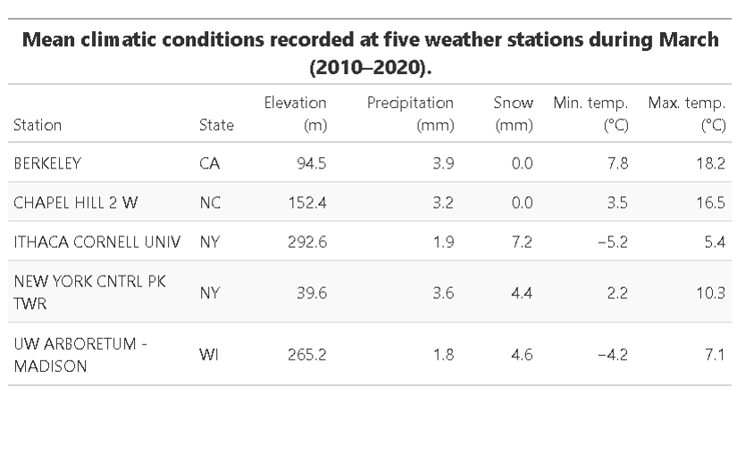

## Introducción

En esta práctica se llevó a cabo la organización de una base de datos la cual contaba con diferentes errores que dificultan su procesamiento y análisis estadístico, a través de la librería "tidydata" la cual permite analizar datos y conflictos.

## Objetivo

Organizar bases de datos que tengan defectos, a través de la librería "tidydata" en R.

## Metodología

**Procesamiento, Limpieza y Estructuración de Datos (*Tidy Data*)**

El procesamiento y depuración de los datos se realizó en el entorno R utilizando el metapaquete tidyverse (particularmente dplyr, tidyr, readr, lubridate y ggplot2) y el paquete gt para la elaboración de tablas. El procedimiento metodológico consistió en las siguientes etapas:

1.   **Reestructuración y Estandarización de Variables:** Se transformaron tablas anchas (*wide format*) a formato largo (*long format*) mediante pivot_longer() para unificar variables temporales (días) en una sola columna. Posteriormente, con pivot_wider(), se reestructuraron las variables climáticas en columnas independientes. Se corrigieron los nombres de los campos de ubicación y estación, y se separaron variables compuestas (por ejemplo, rangos de temperatura divididos en temperature_min y temperature_max, e información taxonómica en class, order y family) utilizando la función separate(). Asimismo, se unificaron el género y la especie (unite()) para conformar el nombre científico binomial.

2.  **Ajuste de Fechas y Tipos de Datos:** Las columnas correspondientes al año, mes y día se combinaron (unite()) y se transformaron a un formato estandarizado de fecha (YYYY-MM-DD) empleando as_date(). Las variables numéricas (precipitación, nieve y temperaturas) fueron convertidas masivamente desde caracteres a tipo numérico con mutate() y across().

3.  Para eliminar la redundancia de datos, la información depurada se dividió en dos entidades o tablas independientes:

    - Tablas de metadatos/atributos fijos (información geográfica de las estaciones climáticas o taxonomía de ungulados).

    - Tablas de registros u observaciones temporales/de campo.

**Análisis Descriptivo y Visualización de Resultados**

A partir de la unión de las tablas procesadas (inner_join()):

- **Gráficos:** Se calcularon promedios de temperatura mínima y máxima por estación, generando un gráfico de rangos mediante ggplot2 (geom_linerange() y geom_point()) ordenado jerárquicamente. Para los datos taxonómicos, se contabilizó la frecuencia de observaciones por especie (count()) y se representó en un gráfico de barras horizontales.  

- **Tablas de Resumen:** Se construyeron cuadros descriptivos resumidos por estación climática o clasificación taxonómica mediante la librería gt.

## Resultados

{width="491"}

## Interpretación

## Conclusiones

## Referencias
