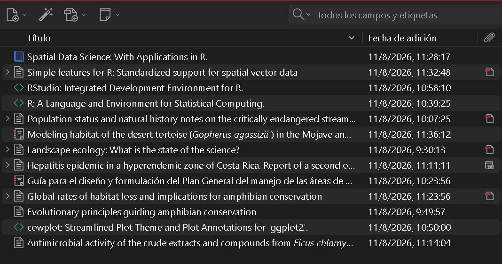

## Introducción

En esta práctica se llevó a cabo la descarga de referencias y su gestión a través de Zotero.

## Objetivo

- Crear y organizar una biblioteca bibliográfica en Zotero.

- Incorporar referencias mediante DOI, archivos RIS y Zotero Connector.

- Revisar y corregir los metadatos de una referencia.

- Instalar y utilizar un estilo bibliográfico.

- Insertar citas y bibliografías automáticamente en Microsoft Word.

- Incorporar referencias que no corresponden a artículos científicos, como
  reportes, páginas web y software.

- Citar R, RStudio y paquetes de R.

## Metodología

Se utilizó Zotero para la creación de referencias bibliográfica.

Se utilizó la extensión del navegador para extraer directamente de la páginas web las referencias y la extensión de Word para organizar de forma eficiente las citas y referencias en un documento.

## Resultados 

Se aprendió sobre los aspectos básicos para el manejo de la aplicación Zotero, llas organización de las referencias bibliográficas y citas tanto parentéticas como de párrafo en un documento Word con un formato de revista determinado. Además, se llevó a cabo la corrección y actualización de la información de la referencias.

Ejemplo de citas creadas:

- Mil personas reportadas[@villarejos_hepatitis_1972]

- Nussear y colaboradores modelaron el hábitat de la tortuga del desierto [@nussear_modeling_2009]

- Se utilizó el paque “sf” v 1.1-2 [@pebesma_simple_2018 ; @pebesma_spatial_2023]

Cuadro 1. Métodos utilizados para incorporar referencias bibliográficas a Zotero.

| Método | ¿Cuándo utilizarlo? |
|----|----|
| DIO | Cuando la publicación tiene un DOI conocido |
| Archivo RIS | Cuando la revista o base de datos permite exportar la referencia |
| Zotero Connector | Para capturar referencias directamente desde el navegador |
| Entrada manual | Cuando la información no puede importarse automáticamente |

## Conclusiones

La plataforma Zotero es una manera eficiente para obtener y crear referencias bibliográficas de diferentes documento bibliográficos, además, facilita de manera eficiente su organización y transformación a diferentes tipos de formatos. Siempre se debe de corroborar que la información esté correctamente redactada y con el orden correcto para evitar errores de formato.

## Referencias
